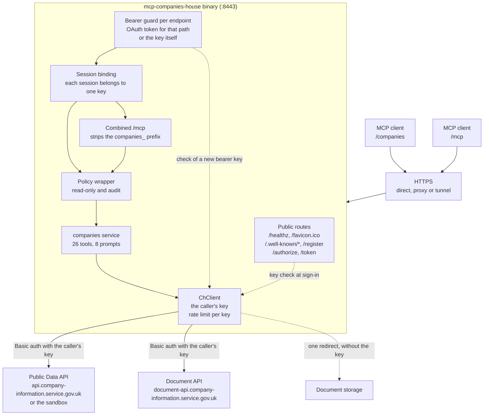
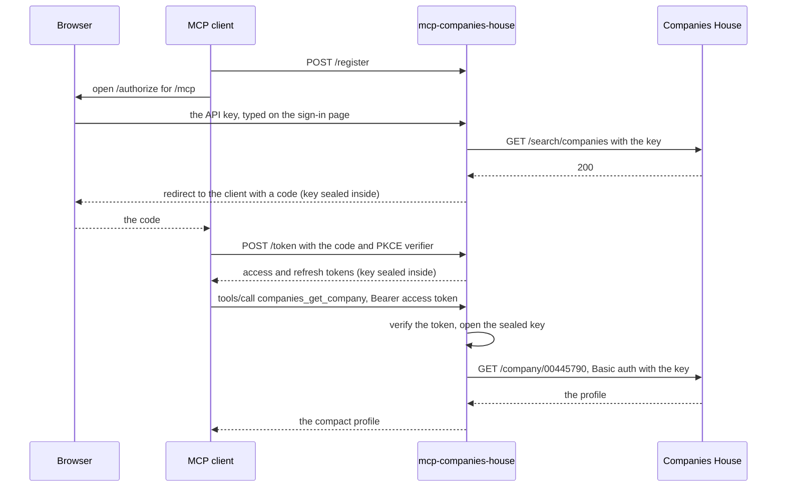

# Architecture

This page describes how the server is built: its crates, the path a request takes from an MCP client to Companies House, how each person's API key travels with their requests, the `Service` trait and the combined endpoint, and the fake Companies House the tests run against. You do not need it to run the server. It is for anyone reading or changing the code.

## Crates

| Crate | Where | Role |
|---|---|---|
| `mcp-companies-house` | `crates/mcp-companies-house` | The binary. It lists the services in `SERVICES`, builds the server from them with mcp-server-core and runs it. It sets the variable prefix `COMPANIES_HOUSE`, makes people sign in with their own key, and supplies the server's icon, served as `/favicon.ico` and in the `serverInfo` of `/mcp` |
| `mcp-companies-house-data` | `crates/mcp-companies-house-data` | The `companies` service: the Companies House HTTP client, its two variables, the key check used at sign-in, the 26 tools and the shapes of their results, the 8 prompts, the SIC 2007 list and the icon `/companies` sends in its `serverInfo` |
| `mcp-server-core` | [crates.io](https://crates.io/crates/mcp-server-core), version 0.1 | The shared base: configuration, the OAuth 2.1 authorization server and its sign-in page, the bearer guards, sign-in limits, MCP sessions, TLS, logging, metrics, the read-only and audit wrapper, service selection, the combined endpoint and the `Service` trait |

[mcp-server-core](https://github.com/Trozz/mcp-server-core-rs) is open source and shared with [mcp-icloud](https://github.com/Trozz/mcp-icloud). The workspace `Cargo.toml` requires `mcp-server-core = "0.1"`. See [Contributing](contributing.md#the-shared-core) for how to change it.

Inside the data service:

| Path under `crates/mcp-companies-house-data` | What it holds |
|---|---|
| `src/api.rs` | `ChClient`: requests to the Public Data API and the Document API, timeouts, the retry, error mapping, rate-limit tracking per key, the document download budget and the Companies House metrics |
| `src/config.rs` | `COMPANIES_HOUSE_API_URL` and `COMPANIES_HOUSE_DOCUMENT_API_URL` |
| `src/verifier.rs` | `ChKeyVerifier`: what the sign-in page asks for, and the check of a key with Companies House |
| `src/service.rs` | `DataService`, the service itself, and `from_env`, which builds it from the environment |
| `src/tools/` | The tools, one module per group: `search.rs`, `people.rs`, `records.rs`, `documents.rs`, `report.rs` and `diligence.rs`. `mod.rs` holds the MCP server, its instructions to the model, the prompt handlers and the argument checks every tool shares |
| `src/view/` | Turns Companies House responses into the compact JSON the tools return |
| `src/prompts.rs`, `prompts/*.txt` | The prompts and their templates |
| `src/codes.rs` | The status, type and subtype codes the advanced search accepts, spelt exactly as Companies House spells them |
| `src/sic.rs`, `data/sic2007.tsv` | The SIC 2007 condensed list and its word search |
| `src/error.rs` | `ChError` and its kinds: `validation`, `not_found`, `auth`, `rate_limited`, `upstream` and `internal` |

The data service reads only its own variables, which all start with `COMPANIES_HOUSE_`. The core reads everything else: the server variables, such as `PUBLIC_URL` and `OAUTH_SIGNING_KEY`, and, under the prefix the binary sets, `COMPANIES_HOUSE_SERVICES`, `COMPANIES_HOUSE_COMBINED` and `COMPANIES_HOUSE_READ_ONLY`.

## Request flow

A tool call passes through these steps:

1. **TLS.** The server terminates TLS itself, from certificate files or with a self-signed certificate, or serves plain HTTP behind a proxy when `INSECURE_HTTP=true`. See [TLS and public access](tls.md).
2. **Public routes.** `/healthz`, `/favicon.ico`, the OAuth metadata under `/.well-known/`, `/register`, `/authorize` (the sign-in page) and `/token` need no token. Request bodies are limited to 1 MiB, and every response carries `X-Content-Type-Options: nosniff`.
3. **Bearer guard.** `/companies` and `/mcp` each have their own guard. It lets a request through with an OAuth access token this server issued for that path, or with a Companies House key sent as the bearer token. Anything else gets `401` with a `WWW-Authenticate` header naming the endpoint's resource metadata, which is where clients start signing in. A key that cannot be checked with Companies House just now gets `503`, and an address with too many rejected or concurrent attempts gets `429`. The guard adds the caller's key to the request.
4. **Session binding.** Each MCP session is tied to the key that opened it. A request naming a session opened with another key is answered `404`, as for a session that does not exist. The MCP transport also checks the `Host` header against the `PUBLIC_URL` host and the loopback names, and the `Origin` header against the `PUBLIC_URL` origin and `ALLOWED_ORIGINS`.
5. **Combined endpoint.** On `/mcp` the request goes to the combined handler, which finds the service from the name's prefix and passes the call on with the plain tool name. On `/companies` the request reaches the service directly.
6. **Policy wrapper.** The core wraps every service's handler with its read-only rule and audit log. Every tool here is marked read-only, so today the wrapper changes nothing.
7. **The tool.** The tool checks its arguments first, so a bad value is refused without a request. It then calls Companies House with the caller's key and shapes the answer.
8. **Companies House.** `ChClient` sends the request to the Public Data API, or to the Document API for a filed document, with the key as the HTTP Basic username and a blank password.

`lookup_sic_codes` is the one tool that makes no request: it answers from the SIC list inside the server.

`ChClient` connects with a 10 second timeout and allows 30 seconds for a request. It retries a request once, after 250 milliseconds, only after a network error or a `5xx` answer. It follows no redirects, except the one the Document API sends for a download (see [In the tool](#in-the-tool)), reads at most 8 MiB of a JSON response, and sends `mcp-companies-house/<version>` as its user agent. It also remembers each key's rate-limit window from the `X-Ratelimit-*` headers: once Companies House says a key has no requests left, its tools answer `rate_limited` until the window resets, without calling Companies House. See [Rate limit](conventions.md#rate-limit).

## How a person's key travels

The server stores no key. A key reaches it on every request, in one of two ways, and the server sends it in readable form only to Companies House.

### Signing in

1. The client registers itself at `/register` and opens `/authorize` in the person's browser.
2. The sign-in page asks for a "Companies House API key". The server trims what was typed and refuses anything not shaped like a key (8 to 64 letters, digits, `-` and `_`) without sending it anywhere.
3. `ChKeyVerifier::check` checks the key with one search request to Companies House, and `verdict` turns the answer into accepted, rejected or could not be checked. Only a rejection counts against the address; for a key that could not be checked, the person is asked to try again. [Keys are never stored](security.md#keys-are-never-stored) lists which answer gives which verdict.
4. The key is then sealed: encrypted and authenticated with ChaCha20-Poly1305, under a key derived from `OAUTH_SIGNING_KEY` with HKDF-SHA256. The sealed key goes into the authorization code, which is valid for 60 seconds, and from there into the access token (1 hour) and the refresh token (30 days). Tokens are JWTs signed with `OAUTH_SIGNING_KEY` (HS256), and an access token is bound to the endpoint it was issued for. However often they are refreshed, a sign-in ends 90 days after it was made.
5. On each request the bearer guard verifies the token, opens the sealed key and adds it to the request.

The client holds the sealed key inside its tokens and cannot read it. Rotating `OAUTH_SIGNING_KEY` makes every token and every sealed key useless, which signs everyone out.

### Sending the key as the bearer token

1. The client sends `Authorization: Bearer <your-api-key>`.
2. A value that is not one of the server's own tokens is treated as a key. If it is not shaped like a Companies House key it is refused without being sent anywhere; otherwise it is checked with Companies House as at sign-in.
3. The verdict is kept in memory under the key's SHA-256 hash, never the key itself, for up to 10 minutes, or 1 minute for a rejected key. Requests that arrive while the same key is being checked share that one check.
4. The guard adds the key to the request.

### In the tool

- A tool takes the key from the request (`CompaniesServer::caller`). A request without one, which would mean the guard is missing, is answered `auth: this request carried no Companies House API key; sign in again`.
- `ChClient` sends the key only to `COMPANIES_HOUSE_API_URL` and to the Document API. The one redirect it follows is the Document API's answer to a download, which points to its document storage. That address is fetched without the key, and only over HTTPS (or plain `http` to a loopback address, for tests).
- Rate-limit windows are kept per key, under the key's SHA-256 hash, for up to 10,000 keys at once.
- The key is never written to disk or to the logs. Logs and the audit log name the person `key:` and 16 hex digits of a hash of the key, keyed by `OAUTH_SIGNING_KEY`.

The limits on key checks and sessions are described in [Security](security.md).

## The Service trait

A service is a library crate that implements `mcp_server_core::service::Service`. The companies service is `DataService` in `src/service.rs`:

| Method | What the companies service returns |
|---|---|
| `name()` | `companies`: its path, OAuth resource and scope |
| `handler()` | The `CompaniesServer` MCP handler, with its tools and prompts, boxed for the combined endpoint, which uses it |
| `router()` | Logs `companies house settings` (the origins of the API and the Document API in use, or `none`), then serves a `CompaniesServer` at `/companies` with the core's `mcp_service` |
| `tool_names()` | The 26 tool names, for the startup log |
| `credential_verifier()` | `ChKeyVerifier`, so people sign in with their own Companies House key |

`from_env` reads the service's two variables and builds its `ChClient`. It records each problem in `env.errors`, so every configuration error is printed together at startup. The binary lists it in `SERVICES` as `("companies", mcp_companies_house_data::from_env)` and builds the server with `SignIn::ServiceCredential`. From that list the core:

- runs the services `COMPANIES_HOUSE_SERVICES` selects, by default all of them. A service that is not selected does not read its configuration.
- takes the sign-in from the one enabled service that defines `credential_verifier`. More than one stops startup, because each service's tools would be handed a credential meant for another.
- refuses `MCP_AUTH_TOKEN` with `MCP_AUTH_TOKEN cannot be used when people sign in with their own Companies House API key`, because a shared token would carry no key.
- mounts each service at `/<name>` as its own OAuth protected resource, with metadata at `/.well-known/oauth-protected-resource/<name>`.

[Contributing](contributing.md#adding-a-service) lists the steps for adding a service.

## Combined endpoint

`/mcp` is the core's combined handler over every enabled service's handler:

- Tools and prompts are named `<service>_<name>`, such as `companies_search_companies` and `companies_due_diligence`. A call is routed by the prefix, which ends at the first `_`; service names never contain one.
- Descriptions, input schemas and annotations are exactly those the service lists on its own path.
- Tool names in a prompt's text get the prefix as well, so the `companies_due_diligence` prompt tells the model to call `companies_due_diligence_check`.
- `/mcp` is its own OAuth resource. A token issued for `/companies` is refused there, and the other way round. A key sent as the bearer token works on both.
- Each service keeps its own read-only rule and audit log, and audit entries record the endpoint as `/mcp`.
- `COMPANIES_HOUSE_COMBINED=false` turns it off; `/mcp` then answers `404`.

See [Combined endpoint](combined.md) for using it.

## The fake Companies House

The tests do not call Companies House. `crates/mcp-companies-house-data/tests/support/fake_ch.rs` runs an in-memory HTTP server on a random port of `127.0.0.1`, shaped like the real API:

- It expects the key `test-api-key` as the Basic username with a blank password, and answers anything else with `401` and an error body shaped like Companies House's.
- It sends `X-Ratelimit-*` headers on every API response, counting down from 600.
- It serves the company, officer and disqualified officer searches, the search across all three, advanced, dissolved and alphabetical search, company profiles and, from `fake_records.rs`, canned officers, appointments, persons with significant control and their statements, filings, charges, insolvency, registers, exemptions, UK establishments and disqualifications. Its search pages behave like the live ones: they are aligned to the page size, and a page that would pass the 1000th match is refused with `416`.
- It serves filed documents under `/docapi/document/{id}` and redirects their content to `/storage/{id}`, which, like the live storage, takes no key.
- Its register is made up: six companies such as `ACME WIDGETS LIMITED` (`00000001`) and `THISTLE SOFTWARE LTD` (`SC000003`), across statuses, types, a subtype, SIC codes, towns and dates.
- It logs every request, with its path, query, `Authorization` and `Accept` headers, so tests can check exactly what was sent. Tests can queue canned responses, make a path always fail with `500`, or delay every response.

The fake speaks plain `http` on a loopback address, which both API variables and the check on the document storage redirect accept, for testing. The binary's own tests build the whole server from environment variables, exactly as `main` does, with `COMPANIES_HOUSE_API_URL` pointing at a closed local port so nothing reaches the network. [Contributing](contributing.md#tests) describes the test layout.

## Design choices

- **No database and no volume.** Tokens are signed JWTs, so a restart signs nobody out. What the server does keep lives in memory and starts empty after a restart: rate-limit windows, cached key checks, MCP sessions and sign-in limits.
- **Each person's own key.** The server needs no Companies House account of its own, and each person has their own rate limit, which nobody else's requests use up.
- **Read only.** Every tool only reads, and the Public Data API cannot change anything at Companies House.
- **Compact answers.** Tools return the fields a reader needs, not the raw responses. Unknown fields of a company profile pass through, as Companies House asks clients to expect fields they have not seen before.
- **Filed text is data.** Company names, addresses and other filed text are written by the public. The server's instructions tell the model to treat them as data, not as instructions, and prompts fence text pasted from elsewhere.
- **Bounded work.** Request bodies, responses and documents have size limits, and filed documents share a download budget of 64 MiB across everyone. See [Filed documents](tools/documents.md).
