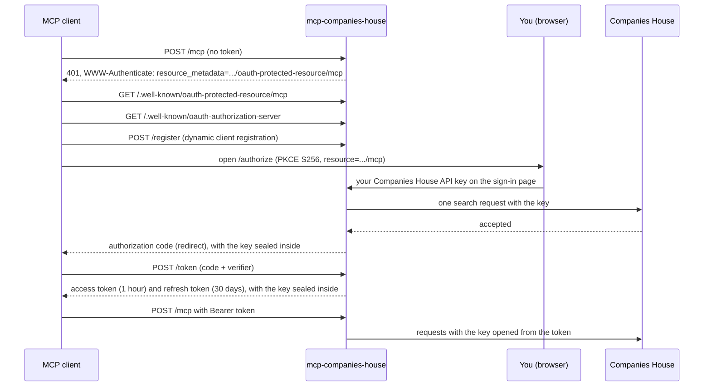

# Security

mcp-companies-house is meant to be reachable from the internet and shared by many people, each signing in with their own Companies House API key. This page explains who can use a server, how keys are checked, sealed and sent, how sessions and sign-in attempts are limited, how long sign-ins last, and what to do if the server's signing key leaks.

## Who can use it

- **Anyone with a valid key.** Anyone who has a Companies House REST API key for the server's environment can sign in. Keys are free and anyone can create one, so treat a server reachable from the internet as open to anyone. To limit who uses it, limit who can reach it, at the network: a firewall, a VPN or an access policy at your tunnel or proxy. claude.ai connects from Anthropic's servers, not from people's own addresses, so an address allow-list that admits people but not claude.ai stops claude.ai connectors.
- **Each person on their own key.** Every Companies House request uses the key of the person making it. Each person has their own rate limit and sees what Companies House serves to their key. The server holds no Companies House key of its own.
- **Nothing can be changed.** Every tool only reads, and the Companies House public data API cannot change anything on the register. `COMPANIES_HOUSE_READ_ONLY` and `AUDIT_LOG_PATH` therefore have nothing to act on today (see [Configuration](configuration.md#variables-with-no-effect-today)).
- **No admin account.** There is no admin password and no shared token. Setting `MCP_AUTH_TOKEN` stops the server at startup.

## Signing in

The server is its own OAuth 2.1 authorization server, built for MCP clients such as claude.ai:

- Only the authorization code flow with PKCE (`S256`) is supported. Clients register themselves (public clients only). A registration may list 1 to 10 redirect addresses, each `https` (or `http` on a loopback host), at most 2048 bytes and without a fragment, user name or password. A client name is at most 200 characters.
- The sign-in page names the endpoint being connected, shows the client's name marked as self-reported and unverified, and shows the host you will be sent to afterwards. It cannot be framed (`X-Frame-Options: DENY` and a strict content security policy) and is never cached.
- The sign-in form is bound to the exact request that opened it and expires after 10 minutes. An authorization code lasts 60 seconds and can be used once. Responses to the client carry the issuer (`iss`, RFC 9207).

## Keys are never stored

When someone signs in on the sign-in page:

1. Spaces around the key are removed, and the key's shape is checked: 8 to 64 letters, digits, dashes and underscores. Anything else is refused with `That is not a Companies House API key.` without contacting Companies House and without counting as a failed attempt.
2. The key is checked with one request to Companies House, a company search (`/search/companies?q=companies+house&items_per_page=2`), made with that key. It counts against that person's own rate limit. A successful answer, or a `400`, `404`, `406`, `416` or `422`, means Companies House accepted the key. `401` rejects it, and `403` rejects it with the message about IP or domain restrictions. A `429`, a server error, a redirect, a timeout or no answer means the key could not be checked, which does not count as a failed attempt.
3. The key is sealed: encrypted and authenticated with ChaCha20-Poly1305, under a key derived from `OAUTH_SIGNING_KEY` with HKDF-SHA256, with a fresh random nonce each time. The sealed key goes into the authorization code, and from there into the access and refresh tokens. The tokens are JWTs signed with `OAUTH_SIGNING_KEY` (HS256).
4. On every request, the server verifies the token, opens the sealed key and uses it for that request's Companies House calls.

The server writes no key to disk, to its logs, to its metrics or to its traces. What it remembers about keys, such as each key's rate-limit window and its sessions, it keeps under the key's SHA-256 hash, never the key. The client holds the key only in sealed form and cannot read it. Rotating `OAUTH_SIGNING_KEY` makes every sealed key unreadable.

## Keys as bearer tokens

Clients that can send a header, such as Claude Code, can send the key itself: `Authorization: Bearer <your-api-key>` (the word `Bearer` in any case).

- The server first checks whether the token is one of its own OAuth tokens. One of its own that has expired, or was issued for another endpoint, is refused and never sent to Companies House.
- Only values shaped like a Companies House key are ever sent to Companies House. Anything else is refused with `401` without being checked or counted.
- A new key is checked with the same search request as at sign-in. The verdict is remembered in memory for 10 minutes for a key that works and 1 minute for a rejected one, under the key's SHA-256 hash, never the key itself. The server remembers up to 10,000 verdicts, and drops rejected ones first when it is full.
- Every Companies House request still uses the key, so a key revoked at Companies House stops working at once: tools answer with the `auth` error.
- A key that cannot be checked right now is not remembered and does not count as a failed attempt. The request is answered `503` with `Retry-After: 30` and `Your Companies House API key could not be checked right now: ...` with the reason.
- A bearer key is not bound to an endpoint: it works on `/companies` and `/mcp`.

## Sessions

Each MCP session belongs to the key that opened it, whether the key came from a sign-in token or as the bearer token.

- A request that names a session opened with another key is answered `404 Session not found`, as if the session did not exist. A leaked session id is of no use to anyone else.
- One key holds at most 50 sessions on each endpoint; `/companies` and `/mcp` count separately. Opening another closes that key's least recently used session.
- One endpoint holds at most 10,000 sessions. When it is full, sessions unused for 6 minutes and sessions that have already ended are cleared first. Then a new session takes the place of the least recently used session of whoever holds clearly more (more than the newcomer's count plus one), so nobody is pushed out by someone holding fewer. A key that already holds sessions replaces its own least recently used one instead.
- Only a key with no session is ever refused, and only when every key holds about the same share. It gets `503` with `Retry-After: 30` and `This server has too many open sessions. Try again shortly.`
- The MCP library logs session ids at its lower levels, so its logging is held at warning level, keeping them out of normal logs and traces. A few of its warnings and errors, such as a session that could not be closed, can still name one.

## OAuth resources and audiences

- Each endpoint is its own OAuth protected resource (RFC 9728): `https://companies-house.example.com/companies` with scope `companies`, and `https://companies-house.example.com/mcp` with scope `mcp`. Their metadata is at `/.well-known/oauth-protected-resource/companies` and `/.well-known/oauth-protected-resource/mcp`, and the authorization server's metadata at `/.well-known/oauth-authorization-server`, with `PUBLIC_URL` as the issuer.
- Access tokens are bound to the endpoint they were issued for (RFC 8707). A token for `/companies` is refused on `/mcp`, and the other way round. A refresh that names a resource must name the one the sign-in was for.
- A client that names no resource when it signs in is signed in for `/companies`, never for `/mcp`. See [Combined endpoint](combined.md#sign-in).
- Every token also carries a keyed hash of how this server signs people in, and the time of the sign-in. A token made by a server that signs people in differently is refused, even with the same signing key and address.

## Limits on key checks

Every key check, on the sign-in page or for a new bearer key, counts as an attempt from the client's address from the moment it starts:

| Limit | Value |
|---|---|
| One client: an IPv4 address, or an IPv6 /64 | 5 attempts in the last minute that were rejected or are still being checked |
| One network: an IPv4 /24, or an IPv6 /48 | 25 attempts in the last minute that were rejected or are still being checked |
| All clients together | Once 30 keys have been rejected in the last minute, a client with a rejection of its own in that minute is refused too |
| Wait asked of a refused client | `Retry-After: 30` |

- Accepted keys and keys that could not be checked are given back when their check ends, so only rejections keep counting. Checks still running count towards the per-client and per-network limits, so parallel guesses cannot get past them, but never towards the 30.
- People who have not failed are not locked out by other people's failures, except those who share a /24 or /48 with someone failing, who can be held up by that network's limit.
- The server tracks up to 10,000 addresses and 10,000 networks. When so many addresses are failing that a new one cannot be tracked, it is judged by its network. Only when the networks cannot be tracked either, and the 30 have been reached, is a new address refused as busy (`503`).
- A check the client abandons still finishes, and counts only if the key was rejected.
- Input that cannot be a key is refused without being checked or counted.
- A bearer key found valid in the last 10 minutes is let in even from a refused address: its holder has already shown they have it. This keeps people behind a shared address working while someone else there is failing.
- Refused requests get `429` with `Too many attempts from this address: ...`, or `503` when the server is refusing new addresses as busy. [Troubleshooting](troubleshooting.md#the-sign-in-page-refuses) has the exact messages.
- The client's address is the TCP peer. Behind a reverse proxy or tunnel, set `TRUSTED_PROXIES` to its address so the server uses the right-most address in `X-Forwarded-For` that is not a trusted proxy. Otherwise everyone shares the proxy's address and its limits. List only proxies you run: a client can put any address in the header.

## Load on Companies House

- At most 16 key checks run at once across the server, each for at most 15 seconds. A check that finds all 16 in use waits up to 5 seconds for a free one, then gives up with `the server is checking too many credentials at once`.
- Requests that arrive with the same new key while it is being checked share that one check.
- When Companies House cannot be reached, or the server is busy, the key is not counted as rejected and the client is asked to retry (`503` with `Retry-After: 30`, on the sign-in page and for bearer keys).
- There is deliberately no overall cap on new key checks, because anyone with enough networks could use it up and keep everyone else from signing in. A server facing a large attack can therefore still be made to send many junk keys to Companies House. If that matters, add rate limits at the network or a reverse proxy (see [Operations](operations.md#request-rate-limits)).

## Token and sign-in lifetimes

| Item | Lifetime |
|---|---|
| Sign-in form | 10 minutes |
| Authorization code | 60 seconds, one use |
| Access token | 1 hour |
| Refresh token | 30 days |
| Sign-in | 90 days from when the person signed in, however often the client refreshes. No token outlives it; then the person signs in again |
| Client registration | No expiry; it ends when `OAUTH_SIGNING_KEY` or `PUBLIC_URL` changes |
| Bearer key verdict | 10 minutes for a key that works, 1 minute for a rejected one |

The server keeps no record of sign-ins, so it cannot sign out one person or one client, and cannot notice a refresh token being reused. Instead:

- **To end your own sign-ins**, revoke or delete your key in the Companies House Developer Hub. The server still accepts the tokens, but every Companies House request uses the key, so from then on every tool call made with a token carrying it answers `auth`.
- **To sign everyone out**, rotate `OAUTH_SIGNING_KEY` (see [Operations](operations.md#rotating-oauth_signing_key)).
- A stolen refresh token works until it expires, the 90 days end or the signing key is rotated. Revoking the key inside it at Companies House makes its tool calls fail.

## How people are named

Where the server names a person, in token subjects and in the log lines of sign-in, it writes `key:` and 16 hex digits, a keyed hash of their key that cannot be turned back into the key, or used to guess it, without `OAUTH_SIGNING_KEY`. [Operations](operations.md#how-people-are-named) describes it in full.

## Where keys are sent

- Only to `COMPANIES_HOUSE_API_URL` and to the Document API (`COMPANIES_HOUSE_DOCUMENT_API_URL`, or the live Document API by default on the live API), as the HTTP Basic user name with a blank password, over verified HTTPS. `http` is accepted only for loopback test addresses.
- Redirects are not followed, with one exception: the Document API answers a document download with a redirect to its storage. The server fetches that one address without the key, and only over `https` (or `http` to a loopback address, for tests), and only if the address carries no user name or password.
- Requests to Companies House identify the server as `mcp-companies-house/<version>`.
- Keys are never sent to clients, written to logs, metrics or traces, or shown in error messages.
- Companies House itself receives every request made with your key, as with any use of its API.

## Filed text is data

Company names, addresses, officers' names, filing descriptions and the text of filed documents are written by whoever filed them, and Companies House does not verify them. The server's instructions tell the model to treat them as data, not as instructions, and every prompt says the same. See [Filed text is data](conventions.md#filed-text-is-data).

## Prompt fences

Two prompt arguments are likely to hold text from someone else: `context` in `due_diligence` and `companies` in `watchlist`. The prompt puts each between tags and tells the model that what is inside is data. A value cannot close its fence or open a new one: a `<` that starts `<context`, `</context`, `<companies` or `</companies`, in any case, is replaced with the look-alike `‹`. Every argument is limited to 2000 characters. See [Pasted text is fenced](prompts.md#pasted-text-is-fenced).

## Other protections

- `/companies` and `/mcp` accept only requests for the `PUBLIC_URL` host or a loopback name, and refuse a browser `Origin` other than the `PUBLIC_URL` origin and `ALLOWED_ORIGINS`, with `403`. This blocks DNS rebinding and cross-site requests.
- Request bodies are limited to 1 MiB.
- Secrets and tokens are compared in constant time.
- Every response carries `X-Content-Type-Options: nosniff`, and `Strict-Transport-Security` when the server serves certificate files (see [TLS and public access](tls.md#hsts)).

## Running several instances

Limits are kept in each server process: sign-in limits, the memory of used authorization codes, bearer key verdicts and each key's rate-limit window. With several instances behind a load balancer, each enforces its own. See [Operations](operations.md#running-several-instances).

## The container

The image is built `FROM scratch`: it holds the static binary and CA certificates only, with no shell, and runs as UID and GID 65532. It needs no volume and no writable filesystem.

## If `OAUTH_SIGNING_KEY` leaks

Whoever holds the signing key can make tokens this server accepts and can open the sealed key in any authorization code or token they captured.

1. Generate a new key (`openssl rand -hex 32`), replace the old one and restart the server (see [Rotating OAUTH_SIGNING_KEY](operations.md#rotating-oauth_signing_key)). Every OAuth sign-in and client registration ends, and every sealed key becomes unreadable to the new server.
2. Ask everyone who signed in on the sign-in page to revoke their Companies House key in the Developer Hub, create a new one and sign in again with it. A key that was captured inside a token could otherwise still be used directly against Companies House.
3. Keys sent only as bearer tokens were never sealed, so the leak does not expose them.

Next: [Operations](operations.md).
